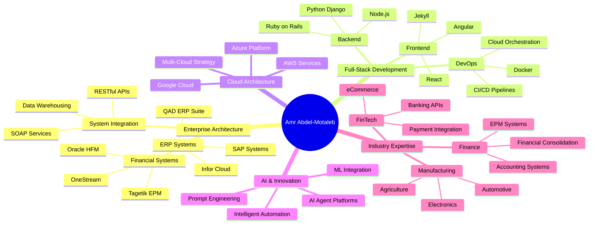

<div align="center">

# 👋 Hi, I'm Amr Abdel-Motaleb

**Solutions Architect | ERP Specialist | Full-Stack Developer**

I build sustainable enterprise systems and empower internal teams, transforming technology from a cost center into a strategic advantage.

[](https://linkedin.com/in/amrabdel) [](https://bashconsultants.com) [](mailto:amr.abdel@gmail.com) [](https://github.com/bamr87/cv/blob/main/cv.pdf)

</div>

---

## 🚀 About me

I'm a **Solutions Architect** and **ERP Specialist** based in Denver, CO, with **15+ years** of experience designing and implementing enterprise systems that drive manufacturing and business operations worldwide. My mission is to bridge the gap between complex business processes and effective technology, always prioritizing people and sustainable growth over vendor dependency.

> [!NOTE]
> Yes, this is a profile README - but it is also a living map of the projects and systems I actively maintain.

**People over profits.** The principles behind my work:

- 🌱 **Sustainable Technology**: Building systems that adapt and scale with your business.
- 👥 **Employee Empowerment**: Transferring knowledge to make your team self-sufficient.
- 📚 **Knowledge Sharing**: Advancing our collective capabilities through open-source education.
- 🌍 **Balanced Innovation**: Integrating environmental and social impact as measurable business drivers.

---

## 🗂️ Portfolio

Every repository I own, grouped by what it is. Each line gives the repo, its one-line description and, when there is one, its live site. Repo descriptions, topics and READMEs follow one [portfolio standard](docs/PORTFOLIO.md), so any README you open has the same shape: overview, features, quick start, structure, development, changelog and license.

Marks: `🧪 experimental` prototype or research · `🛠️ maintenance mode` fixes only · `💤 unmaintained` parked, not archived · `🍴 fork` of someone else's project. There are no private or GitHub-archived repos at the moment; they would be marked `🔒 private` (name and description only) and `🗄️ archived`.

> [!IMPORTANT]
> Most projects evolve quickly - always check each repository README for current setup steps and branch details before running commands.

<!-- AUTO:projects START - generated by .github/scripts/dash-gen; edit _data/projects.yml -->

### 🛰️ Fleet platform & standards

The control plane, shared CI and the standards every repo follows.

- **[.github](https://github.com/bamr87/.github)**: Shared reusable GitHub Actions workflows, release-please setup and community health files for every bamr87 repo.
- **[bamr87](https://github.com/bamr87/bamr87)**: Amr's profile README and fleet control-plane monorepo: ~40 project submodules, shared standards, CI and dashboards. · [live site](https://bamr87.github.io/bamr87/)
- **[README](https://github.com/bamr87/README)**: Context engine for the bamr87 fleet: crawlers and distillers that build queryable docs for every project, incl. MCP. · [live site](https://bamr87.github.io/README/)
- **[SCHEMA](https://github.com/bamr87/SCHEMA)**: Pyramid Schema: the SCHEMA.md protocol and linter that let AI agents look up repo structure instead of guessing it.
- **[scripts](https://github.com/bamr87/scripts)**: Standalone Bash utilities for project scaffolding, GitHub repository management and multi-repo maintenance.

### 🎨 zer0 Jekyll ecosystem

The zer0-mistakes theme and the plugins, CMS and demo sites built around it.

- **[zer0-CMS](https://github.com/bamr87/zer0-CMS)**: The zer0 stack in one repository: an agent-native headless CMS (Django/Wagtail content plane, Rails experience plane, VS Code extension) plus the image generator, books app, barodybroject and the zer0 sites, each imported with its history; the theme is developed in bamr87/zer0-mistakes again (ADR 0005). · `🍴 fork`
- **[zer0-demo-cookbook](https://github.com/bamr87/zer0-demo-cookbook)**: The Sunday Braise: a demo cookbook site for the zer0-mistakes Jekyll theme, generated by its Site Builder. · [live site](https://bamr87.github.io/zer0-demo-cookbook/)
- **[zer0-demo-garden](https://github.com/bamr87/zer0-demo-garden)**: Marginalia: a demo digital garden for the zer0-mistakes Jekyll theme, with Obsidian wiki-links and backlinks. · [live site](https://bamr87.github.io/zer0-demo-garden/)
- **[zer0-mistakes](https://github.com/bamr87/zer0-mistakes)**: AI-native, Docker-first Jekyll theme for GitHub Pages sites, built on Bootstrap 5 and published as a Ruby gem, with zer0 studio — the Rails workbench that designs, customizes and updates it. · [live site](https://zer0-mistakes.com)

### 🌐 Websites

Personal and business sites.

- **[bamr87.github.io](https://github.com/bamr87/bamr87.github.io)**: Amr Abdel-Motaleb's personal profile, résumé and project portfolio site, built with Jekyll on GitHub Pages. · [live site](https://bamr87.github.io)
- **[bash-365-apex](https://github.com/bash-365/bash-365-apex)**: Client-side redirect from the bash-365.com apex domain to www, served by GitHub Pages for BASH Consulting. · [live site](https://bash-365.com)
- **[lifehacker.dev](https://github.com/bamr87/lifehacker.dev)**: Tech knowledge, tools and comedy at lifehacker.dev: a Jekyll site on the zer0-mistakes theme, run by Claude Code. · [live site](https://lifehacker.dev)

### 📚 Knowledge bases & learning

Self-growing knowledge bases, study material and learning platforms.

- **[it-journey](https://github.com/bamr87/it-journey)**: Gamified, open-source platform for learning IT and software development through hands-on quests, zer0 to her0. · [live site](https://it-journey.dev)

### 🤖 AI applications & research

Applications and experiments built on LLMs.

- **[law-ai](https://github.com/bamr87/law-ai)**: Open legal-intelligence platform for prospective law students (LSAT lab), law students and practicing lawyers: Django + CrewAI/LangGraph agents over a Neo4j knowledge graph, Claude-first provider chain with a local Ollama tier. Runs the fleet's spec-driven loop by reference. · [live site](https://bamr87.github.io/law-ai/) · `🧪 experimental`
- **[ocrmd](https://github.com/bamr87/ocrmd)**: Scan books and pages into cross-checked Markdown: local OCR diffed against a Claude vision read, with full-text search.
- **[outbox](https://github.com/bamr87/outbox)**: Async competitive outbox harness for three agents: mailbox protocol, injected lag, confidence race and replay scorer. · `🧪 experimental`

### 🧠 AI agents & SDLC automation

Frameworks that put AI agents to work on repositories.

- **[ai-seed](https://github.com/bamr87/ai-seed)**: Self-evolving project template: plant a kernel in any repo and let Claude Code Actions germinate and grow it. · `💤 unmaintained`
- **[bashos](https://github.com/bamr87/bashos)**: Terminal-first AI runtime that routes Claude slash commands through a LangGraph kernel onto the OpenCode engine.
- **[githubai](https://github.com/bamr87/githubai)**: Claude Code SDLC framework: reusable GitHub Actions that triage issues, implement work, review PRs and cut releases.
- **[gitorio](https://github.com/bamr87/gitorio)**: Factorio-style factory builder for GitHub automation: blueprints compile to Actions workflows running Claude Code. · [live site](https://bamr87.github.io/gitorio/)

### 💼 Business & career apps

ERP, finance data and CV tooling.

- **[djangoerp](https://github.com/bamr87/djangoerp)**: Modular Django REST ERP: double-entry accounting, inventory, purchasing, sales, manufacturing and MRP planning. · `🧪 experimental`
- **[fredgar-ai](https://github.com/bamr87/fredgar-ai)**: Django + React app for exploring SEC EDGAR company data and FRED macro series, with AI-assisted summaries. · [live site](https://bamr87.github.io/fredgar-ai/)

### 🛠️ Developer tools & extensions

VS Code extensions and terminal tooling.

- **[vs-sonic-pi](https://github.com/bamr87/vs-sonic-pi)**: VS Code extension to write and perform Sonic Pi music live: IntelliSense, hover docs, built-in tutorial, OSC control. · `🛠️ maintenance mode`
- **[zpl-viewer](https://github.com/bamr87/zpl-viewer)**: Label Studio: offline VS Code extension to read, preview, create, merge and deploy ZPL II and EPL2 thermal labels.

### 🕹️ Games & retro computing

Games, game frameworks and retro emulation.

- **[bashcrawl](https://github.com/bamr87/bashcrawl)**: Learn real terminal skills by playing a fantasy dungeon crawl in your shell or in a free browser trainer. · [live site](https://bamr87.github.io/bashcrawl/) · `🛠️ maintenance mode`
- **[godotgo](https://github.com/bamr87/godotgo)**: Godot 4 game workspace: one reusable framework, five sample games and tooling that treats every project the same.
- **[rewind-arcade](https://github.com/bamr87/rewind-arcade)**: Retro gaming workspace: browser arcade recreations, console emulation via ES-DE, and a physical game catalog. · [live site](https://bamr87.github.io/rewind-arcade/)

### 🔗 Related projects (not owned by bamr87)

Upstreams vendored into the fleet hub, and repos that moved to other owners.

- **[archify](https://github.com/tt-a1i/archify)**: Agent skill that compiles typed JSON IR into validated, self-contained HTML system diagrams — the hub vendors it to illustrate the harness and its loops (diagrams/, /harness/). · [live site](https://tt-a1i.github.io/archify/) · `🛠️ maintenance mode`
- **[csv-vscoode](https://github.com/bash-365/csv-vscoode)**: CSV Grid Viewer — VS Code extension to view .csv files in a grid and sum selected cells. · `💤 unmaintained`
- **[skills](https://github.com/microsoft/skills)**: Microsoft Agent Skills — reusable markdown skills, MCP servers, and custom agents to ground coding agents. · `🛠️ maintenance mode`

### 🍴 Forks

Personal forks of other projects.

- **[amrchy](https://github.com/bamr87/amrchy)**: Personal fork of Omarchy (omacom/omarchy), the opinionated Arch Linux + Hyprland desktop setup. · `🍴 fork`

### 📚 Documentation & Knowledge Platforms

- **[ai-world-view.github.io](https://github.com/ai-world-view/ai-world-view.github.io)**: AI World View — the root site of the self-growing country knowledge-base network; the per-country repos hang off it. · [live site](https://ai-world-view.github.io/)
- **[bash-365-apex](https://github.com/bash-365/bash-365-apex)**: Client-side redirect from the bash-365.com apex domain to www, served by GitHub Pages for BASH Consulting. · [live site](https://bash-365.com) · `🛠️ maintenance mode`
- **[bash-365.com](https://github.com/bash-365/bash-365.com)**: BASH Consulting's website at bash-365.com — a content site the content atlas already tracks, now checked out in the hub too. · [live site](https://bash-365.com/)
- **[year-of-ai.github.io](https://github.com/year-of-ai/year-of-ai.github.io)**: Year of AI — the organization's root site and content hub, rendering the shared zer0-mistakes theme via remote_theme; the lineage's year repos hang off it. · [live site](https://year-of-ai.github.io/)

### 🚀 Full-Stack & AI Applications

- **[cv-pro](https://github.com/bamr87/cv-pro)**: CV as code and the CV Builder Pro app in one repository: cv/ holds the data, the CVData contract and every render; app/ is the React builder.

### 🛠️ Developer Tools & Experiments

- **[amrchy](https://github.com/bamr87/amrchy)**: Personal fork of Omarchy (omacom/omarchy), the opinionated Arch Linux + Hyprland desktop setup. · `🛠️ maintenance mode`
- **[godotgo](https://github.com/bamr87/godotgo)**: Godot 4 game workspace: one reusable framework, five sample games and tooling that treats every project the same. · `🧪 experimental`

<!-- AUTO:projects END -->

### 📚 Where I write

I believe in continuous learning and sharing knowledge. I document my journey through three interconnected platforms:

> [!TIP]
> If you are new here, start with `it-journey.dev`, then jump into the repo links below for implementation details.

- 🎯 **[it-journey.dev](https://it-journey.dev)**: In-depth tutorials on enterprise systems, DevOps, and cloud architecture.
- 🎨 **[zer0-mistakes.com](https://zer0-mistakes.com)**: A showcase of software architecture patterns, UI/UX design, and system design methodologies.
- 🚀 **[barodybroject](https://bamr87.github.io/barodybroject/)**: A playground for full-stack applications, experimental projects, and integration showcases.

[](https://roadmap.sh)

---

## 📁 This repository

Besides being my profile, this repo is the **control plane** for the portfolio: a monorepo that mounts about 40 of the projects above as Git submodules under `projects/`, plus the shared standards, CI, dashboards and AI harnesses that keep them consistent. The dash is live at [bamr87.github.io/bamr87](https://bamr87.github.io/bamr87/).

```
bamr87/
├── projects/    # the fleet: one Git submodule per project
├── _data/       # registries: projects.yml (the fleet), portfolio.yml (this index), profile.yml
├── specs/       # the Universal Project Standard (REPOSITORY, QUALITY, WORK, ...)
├── templates/   # kits fanned out to every repo (CI, schema, community files, ...)
├── tools/       # dash, drift gate, fan-out and conformance tooling
├── .github/     # workflows, dash-gen and the shared CI gate
└── docs/        # monorepo documentation
```

## 🚀 Quick start

Clone with all submodules:

> [!TIP]
> Use `--recurse-submodules` on the first clone to avoid missing nested project dependencies.

```bash
git clone --recurse-submodules https://github.com/bamr87/bamr87.git
cd bamr87
./tools/setup.sh
```

## 📖 Documentation

- **[docs/README.md](docs/README.md)**: The index of every document in the hub, generated from each document's summary line
- **[AGENTS.md](AGENTS.md)**: How to work in the hub — commands, layout, conventions, the standing rules and the loops (canonical for agents and contributors)
- **[docs/SUBMODULES.md](docs/SUBMODULES.md)**: The submodule workflow — commit in the submodule, then bump the pointer
- **[docs/DEVELOPMENT.md](docs/DEVELOPMENT.md)**: Development environment setup
- **[docs/DASH.md](docs/DASH.md)**: The dash architecture — registry, surfaces, gates, AI loop
- **[CONTRIBUTING.md](CONTRIBUTING.md)**: Contribution guidelines
- **[docs/PORTFOLIO.md](docs/PORTFOLIO.md)**: The portfolio standard — descriptions, topic taxonomy, homepage rule and README skeleton

To change this index, edit [`_data/projects.yml`](_data/projects.yml) (fleet members) or [`_data/portfolio.yml`](_data/portfolio.yml) (grouping and display-only extras), then run `tools/dash-gen readme`. The `AUTO:projects` block is regenerated daily by the refresh-dash workflow.

## 📄 License

The hub's own machinery is [MIT-licensed](LICENSE); every project under `projects/` carries its own license.

---

## 💼 Experience & skills

<details>
<summary><b>💼 Professional experience</b></summary>

### 🔷 AESSE Investments - ERP Architect (2025-Present)
Leading enterprise architecture for polymers and automotive manufacturing across North America, focusing on ERP governance, technical oversight, and strategic roadmap development.

### 🔷 BASH Consulting LLC - Solutions Architect (2020-Present)
Providing comprehensive IT/Finance consulting with a mission-driven focus on employee empowerment and sustainable technology.

**Key Achievements**:
- ✅ **Enterprise Systems**: Led 4 major enterprise projects, including QAD EE upgrades, multi-system integrations (banking, supplier portals), and OneStream/HFM implementations for financial consolidation.
- ✅ **Accounting Modernization**: Re-engineered accounting systems through QAD entity segmentation and QuickBooks configurations for streamlined financial operations.
- ✅ **Custom Software Development**: Built 3 custom applications, including inventory tracking systems and a home inspection platform, using Ruby on Rails and JavaScript.
- ✅ **Cloud & Data Governance**: Designed robust data governance frameworks and system architecture for RPM Telco and other financial systems, managing multi-cloud environments across AWS, GCP, and Azure.
- ✅ **BI & Analytics**: Developed high-impact PowerBI dashboards, financial models, and operational reports to drive data-driven decision-making.
- ✅ **Skills Transfer Programs**: Successfully executed knowledge transfer programs, creating comprehensive documentation and training that empowered client teams to manage their systems independently.

### 🔷 Valmont Industries - Sr. Manager Financial Systems (2022-2023)
Led global accounting systems strategy for a multi-billion dollar agriculture and infrastructure manufacturer.
- ✅ **Compliance & Localization**: Designed and implemented a Mexico localization compliance solution with deep IFS integration.
- ✅ **System Centralization**: Drove 3 major centralization projects for BlackLine Cash App, SAP Concur, and BlackLine GL, standardizing processes across the enterprise.
- ✅ **Data Integration**: Architected 4 critical ERP interfaces for a supplier portal, invoice automation, account reconciliation, and a OneStream direct connect, improving data flow and efficiency.
- ✅ **Analytics & Reporting**: Built enterprise-grade data analytics solutions, including Revenue Recognition, GL, and AR InfoMarts, and developed a centralized Chart of Accounts (COA) reporting structure.

### 🔷 Previous Roles (2009-2022)
- **AsteelFlash - Global Business Analyst, Finance (2018-2020)**: Managed 20+ ERP implementations (QAD, SAP, SyteLine) across North America, Europe, and Asia.
- **Wolters Kluwer - Senior Business Consultant, Tagetik EPM (2017-2018)**: Implemented multiple EPM solutions (Tagetik, HFM, OneStream).
- **QAD Inc. - Finance IT Business Consultant (2014-2017)**: Specialized in EAM, FAM, and lease management systems.
- **Infor Global Solutions - Applications Consultant (2012-2014)**: Focused on Baan IV and Infor LN ERP solutions.
- **Navistar International - ERP/Baan Specialist & Financial Analyst (2009-2012)**: Started my career in ERP and financial analysis in a large-scale manufacturing environment.

</details>

<details>
<summary><b>🎯 Consulting services</b></summary>

My consulting practice is built on a foundation of empowering your team and delivering sustainable, long-term value.

#### **Enterprise Architecture & ERP Solutions**
Transform business operations through manufacturing-focused ERP implementations and strategic technology planning.

- 🏗️ **ERP Implementation & Optimization**: QAD, Infor, Oracle, SAP systems for global manufacturing
- 🔄 **Legacy System Modernization**: Upgrade pathways and cloud migration strategies
- 🔗 **System Integration**: Banking interfaces, supplier portals, multi-system connectivity
- 📊 **Business Process Optimization**: Workflow automation, shop floor integration, lean manufacturing

#### **Financial Technology & Automation**
Streamline financial operations with enterprise-grade accounting technology and compliance solutions.

- 💰 **Financial Systems Design**: OneStream, BlackLine, Hyperion implementations
- 🤖 **Process Automation**: AP/AR automation, bank reconciliations, financial close acceleration
- 📈 **Enterprise Performance Management**: Consolidation, planning, budgeting, forecasting
- ✅ **Compliance Solutions**: SOX controls, GAAP/IFRS compliance, regulatory reporting

#### **Cloud & Full-Stack Development**
Build modern applications and cloud infrastructure that scale with your business.

- ☁️ **Cloud Architecture**: AWS, Azure, GCP design and management with CI/CD pipelines
- 🖥️ **Custom Application Development**: Django, Ruby on Rails, Angular web applications
- 🤖 **AI Integration**: Intelligent automation, AI agent platforms, prompt engineering
- 📊 **Data Engineering**: BI dashboards (PowerBI), data warehouses, analytics platforms

#### **IT Strategy & Employee Empowerment**
Future-proof your technology investments while building internal capabilities.

- 🎓 **Skills Development Programs**: Technical training, certification guidance, knowledge transfer
- 🏢 **Center of Excellence**: Innovation labs, best practice documentation, internal capabilities
- 🛡️ **Technology Risk Management**: Vendor independence strategies, cybersecurity frameworks
- 📋 **Strategic Advisory**: Technology roadmaps, investment planning, emerging tech evaluation

</details>

<details>
<summary><b>🤝 Let's collaborate</b></summary>

### 💡 Innovation & Collaboration Focus

- 🌱 **Sustainable ERP Design**: How can we quantify environmental impact alongside profit in ERP systems?
- 👥 **Empowerment Through Technology**: Developing programs that build internal capabilities, not vendor dependencies.
- 🤖 **AI-Augmented Intelligence**: Using AI to enhance human decision-making, not replace it.
- 🔗 **Future-Proof Architecture**: Designing modular, API-first systems that evolve with business needs.
- 📊 **Data-Driven Social Impact**: Using BI to measure and optimize financial, community, and environmental performance.

</details>

<details>
<summary><b>📦 Enterprise Applications</b></summary>

- **ERP Systems**: QAD (SE, EE, Mfg/Pro, eB2, AUX), Infor (SyteLine, LN, Baan IV), SAP
- **Financial Management**: Oracle HFM, OneStream, Tagetik EPM, PeopleSoft Financials
- **Specialized**: QAD EAM, Oracle Agile PLM, BlackLine, SAP Concur

</details>

<details>
<summary><b>💻 Programming & Scripting</b></summary>

```
Primary:     Python, Bash, Ruby, JavaScript, SQL
Secondary:   PowerShell, C#, Visual Basic, PHP
Specialized: Progress 4GL, LaTeX, MDX, DAX
Web:         HTML5, CSS3, XML, JSON
```

</details>

<details>
<summary><b>🗄️ Databases & Data Platforms</b></summary>

- **Cloud**: DataBricks, Google BigQuery, AWS DynamoDB
- **Relational**: Microsoft SQL Server, PostgreSQL, MySQL, Oracle SQL
- **Specialized**: Progress DB, Teradata

</details>

<details>
<summary><b>📊 Analytics & BI Tools</b></summary>

- PowerBI, Alteryx, Python (Pandas, NumPy, Matplotlib)
- SQL, DAX, MDX
- Hyperion Reporting Studio, OBIEE Dashboards

</details>

<details>
<summary><b>☁️ Cloud & DevOps</b></summary>

- **Cloud Platforms**: AWS, Azure, Google Cloud Platform
- **DevOps**: Git, Docker, CI/CD Pipelines, Automated Testing
- **Integration**: RESTful APIs, SOAP, QXtend, Apache Tomcat
- **Automation**: Microsoft Power Automate, Zapier

</details>

<details>
<summary><b>🤖 AI & Modern Development</b></summary>

- AI Agent Platform Development
- Prompt Engineering
- Django & Ruby on Rails frameworks
- Angular & React front-end development
- Jekyll static site generators

</details>

<details>
<summary><b>🧭 Career map</b></summary>



</details>

### 🎓 Education

**Bachelor of Science (BS), Finance** *Northern Illinois University* Focus: Corporate Finance

---

## 📬 Get in touch

- 💼 **LinkedIn**: [linkedin.com/in/amrabdel](https://linkedin.com/in/amrabdel)
- 🌐 **Website**: [bashconsultants.com](https://bashconsultants.com)
- 📧 **Email**: [amr.abdel@gmail.com](mailto:amr.abdel@gmail.com)
- 📄 **CV**: [Download PDF](https://github.com/bamr87/cv/blob/main/cv.pdf)
- 🐙 **GitHub**: [@bamr87](https://github.com/bamr87)

---

## 📊 GitHub stats

<div align="center">

 

</div>

<div align="center">

*Last updated: October 2026*

</div>
