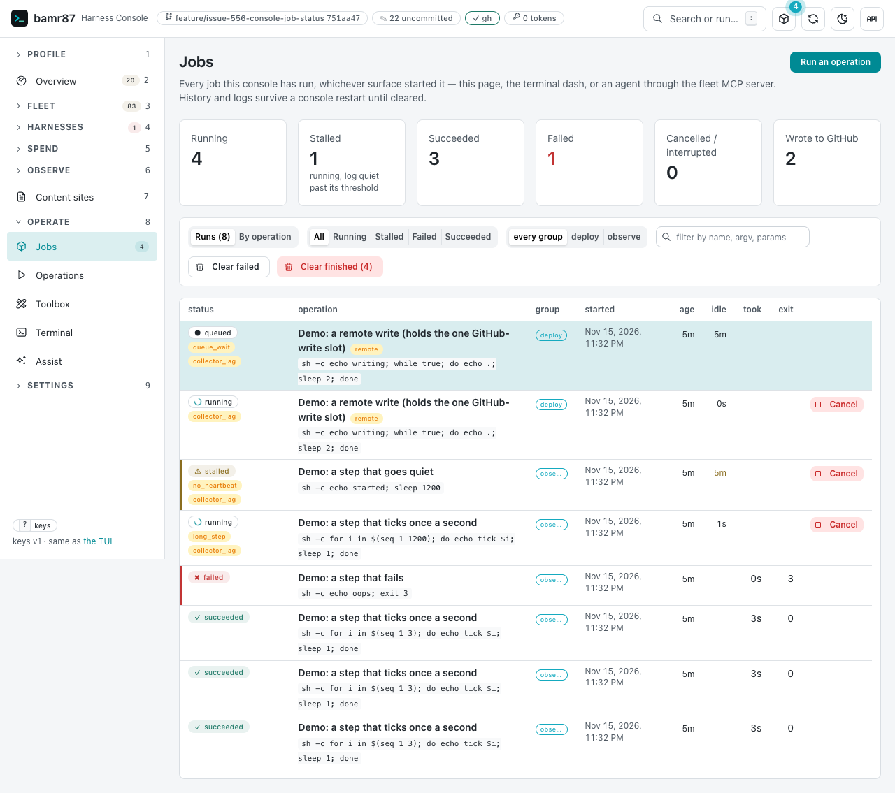

# Job status for agents

> Shipped (feature HUB-064, requirement FR60, roadmap FF-0033, bamr87/bamr87#556): the bot that sent a console job sees its state, its ages and why it may be slow, through the API, the MCP layer and the Jobs page.

## Problem

A job sent through the console (`run_op`, `job_dispatch`) returns a receipt. `jobs_list` and `job_log` showed the raw `status` and the log, but not whether a running job was still making progress or why it was slow. A slow Claude Code session lookup could not be diagnosed this way.

## What it adds

Every job, whenever the console reads it, carries these fields beside its raw `status`:

| Field | Meaning |
| --- | --- |
| `state` | `queued`, `running`, `stalled`, `done` or `failed` |
| `age_s` | seconds since the job was sent (`created`) |
| `idle_s` | seconds since its last progress: since its log last grew, or since it started when the log has not grown; for a queued job, since it was sent; `null` once it finished |
| `stall_s` | the threshold this job is held to: `idle_s` past it makes a running job `stalled` |
| `diagnostics` | the reasons it may be slow, each `{code, detail}`; empty once it finished |

`state` comes from `status` and progress. `queued` stays `queued`. `running` becomes `stalled` when `idle_s` passes `stall_s`. `succeeded` is `done`, and `failed`, `cancelled` and `interrupted` are `failed`; the exact outcome stays in `status` and the exit code in `exit_code`.

A heartbeat is a log line, so log growth (the log file's modification time) is the one sign of progress. The threshold is 120 s (`core.STALL_S`). An operation whose output is quiet for longer by design overrides it in its `OPS` entry with `stall_s`: `loop-run` and `conflicts-resolve` use 600 s, because a model session's stream is quiet while one tool call, such as a test suite, runs.

Diagnostic codes:

| Code | When | Read from |
| --- | --- | --- |
| `queue_wait` | a queued job waits behind a live job holding the same `exclusive` key (the lake, one loop's run), or a queued GitHub-writing job waits behind the running one (one remote write at a time); the detail names the job it waits on. The `exclusive` case is a guard only: `submit` refuses a second job whose key is held (a 409), so on a console the wait you see is the GitHub-write slot | the other jobs in the runtime |
| `collector_lag` | a live job, while the live collector's `.dash-live/sessions.json` is older than `live.STALE_S` (30 s, six of the collector's 5 s intervals): a Claude Code session lookup reads old data. A missing file means no collector on this host and says nothing | `live.collector_age()` |
| `long_step` | a running job past the p90 duration of its operation's most recent successful runs (up to 20, at least 3) and past 30 s, so a quick operation is not flagged for a few seconds' wobble | the job index |
| `no_heartbeat` | a running job whose `idle_s` passed `stall_s`; it is why the state reads `stalled` | the job's log |

Nothing new is stored: the fields are derived each time from the job, its log, the other jobs and the collector's file, so the index (`jobs.json`) keeps its shape and a job from an older index reads the same way.

## Surfaces

- API: `GET /api/jobs/{id}/status` answers the job's id, operation, title, group, raw status, exit code, timestamps, `remote_write` and `exclusive`, then the fields above, without the log; an unknown id is a 404. `GET /api/jobs` rows and the `job` of `GET /api/jobs/{id}` carry the same fields.
- MCP (read tools): `job_status(job_id)`, and `jobs_list` rows carry the fields, with a `state` filter beside `status`. A console older than this route answers `job_status` with an error that names #556 and points at `job_log`. `job_dispatch` names `job_status` as the next call.
- UI: the Jobs page shows a `stalled` badge where the raw status would say `running`, a Stalled tile and filter, an age and an idle column, and the diagnostics as badges whose tooltip carries the sentence. The job page and the run drawer show the ages and the full diagnostics.

On the published page the Jobs list holds the hub's workflow runs read from GitHub, which carry none of these fields; the age column falls back to the run's creation time.

## Code and tests

`stall_threshold`, `collector_lag` and `JobManager.status` / `_progress` in [`../core_jobs.py`](../core_jobs.py) (each still reached as `core.<name>`: [`../core.py`](../core.py) re-exports them), `collector_age` in [`../live.py`](../live.py), the route in [`../app.py`](../app.py), `job_status` and `jobs_list` in [`../mcp_layer/server.py`](../mcp_layer/server.py), and `JobStatus` / `JobDiagnostics` in [`../web/src/jobs/JobStatus.tsx`](../web/src/jobs/JobStatus.tsx).

`python3 tools/console/test_console.py` covers each state and diagnostic, the per-operation threshold, the index keeping its shape, and (with FastAPI) the route and its 404. `python3 tools/console/test_mcp_layer.py` covers `job_status`, its errors and the `state` filter. Evidence: [`test/evidence/console-job-status/`](../../../test/evidence/console-job-status/README.md).
